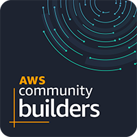

<!-- Header banner -->
<p align="center">
  
</p>

<!-- Typing animation -->
<p align="center">
  <a href="https://github.com/penadev">
    
  </a>
</p>

<!-- Social links (icons hosted in this repo, so they always load) -->
<p align="center">
  <a href="https://youtube.com/penarocks"></a>&nbsp;
  <a href="https://youtube.com/penarocks"><b>YouTube</b></a>
  &nbsp;&nbsp;•&nbsp;&nbsp;
  <a href="https://www.linkedin.com/in/nandopena/"></a>&nbsp;
  <a href="https://www.linkedin.com/in/nandopena/"><b>LinkedIn</b></a>
  &nbsp;&nbsp;•&nbsp;&nbsp;
  🌐 <a href="https://www.penarocks.com"><b>penarocks.com</b></a>
</p>

---

## 👋 Hey, I'm Fernando Pena

I design and ship cloud platforms on **AWS** — and lately, a lot of **agentic AI** on top of them.

By day I lead the AWS practice as **Head of Cloud Services**. Outside of that, I'm an **AWS Community Builder**, I organize the **[AWS User Group Miami](https://miamiawsusergroup.com)**, and I teach cloud on YouTube and my website as **Pena Rocks**.



- ☁️ **Cloud architecture** — migrations, modernization, well-architected landing zones
- 🤖 **Generative & agentic AI** — Amazon Bedrock, agents, MCP servers, Claude Code workflows
- 🏗️ **Practice leadership** — building teams, offers, and AWS partner programs
- 🎙️ **Community** — meetups, talks, videos, and lots of whiteboards
- 🎓 B.Sc. Computer Science · MBA in IT Management · developer since **2003**

---

## 🧠 `fernando-pena.ts`

```typescript
const fernandoPena = {
  location: "South Florida 🌴",
  role: "Head of Cloud Services",
  cloud: { primary: "AWS", alsoSpeaks: ["Azure", "GCP"] },
  currentlyBuilding: ["Agentic AI on Bedrock", "MCP servers", "Serverless SaaS"],
  community: ["AWS Community Builder", "AWS User Group Miami organizer"],
  languages: ["Português 🇧🇷", "English 🇺🇸"],
  motto: "Learn it. Build it. Teach it.",
};

while (fernandoPena.isAlive) {
  learn(); build(); share(); haveFun();
}
```

---

## 🌴 Let's connect

Speaking at a meetup, recording a video, or just want to talk cloud & AI?
Find me at **[AWS User Group Miami](https://miamiawsusergroup.com)** or ping me on **[LinkedIn](https://www.linkedin.com/in/nandopena/)**.

<p align="center">
  
</p>
